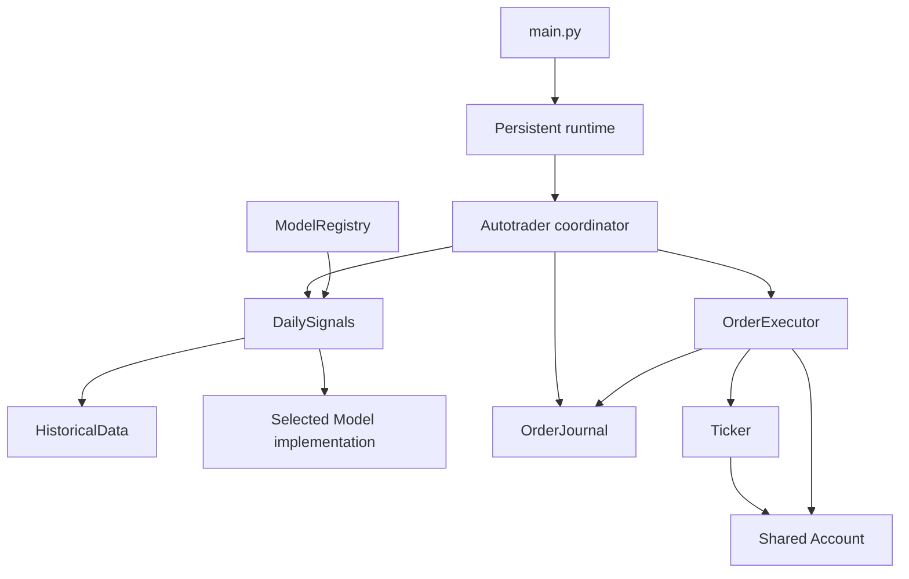

# Development and testing

## Environment

Use Python 3.13 and uv. Local runtime depends on POSIX file locking and interval
signals, so use macOS/Linux, or run the Linux container on Windows.

```sh
uv sync --group dev
uv run python src/main.py
# Equivalent module entry point:
uv run python -m src.main
```

Both entry points start the same persistent service. `--help` prints usage,
`--healthcheck` checks the heartbeat, and unsupported arguments return exit 2.
Configuration is supplied through environment variables.

## Source layout

| Package / file | Responsibility |
| --- | --- |
| [main.py](../src/main.py) | Stable entry point and process lock |
| [core/contracts.py](../src/core/contracts.py) | Abstract Model/Trader interfaces and decision dispatch |
| [core/types.py](../src/core/types.py) | Shared bars, histories, candidates and portfolio limits |
| [core/registry.py](../src/core/registry.py) | Discover MODEL exports and expose strategy metadata |
| [models/cross_sectional.py](../src/models/cross_sectional.py) | Existing cross-sectional research strategy |
| [configuration/settings.py](../src/configuration/settings.py) | Validated live controls, dotenv persistence and revision checks |
| [trading/runner.py](../src/trading/runner.py) | Broker checks and cycle coordination |
| [trading/signals.py](../src/trading/signals.py) | Selected model lifecycle and daily preparation |
| [trading/execution.py](../src/trading/execution.py) | Trader implementation with shared execution guards |
| [data/historical.py](../src/data/historical.py) | Historical data retrieval and alignment |
| [brokers/account.py](../src/brokers/account.py) | Account connection and Ticker lookup |
| [infrastructure/service.py](../src/infrastructure/service.py) | Persistent loop, heartbeat, signals and deadlines |
| [infrastructure/journal.py](../src/infrastructure/journal.py) | Daily attempt reservations and order IDs |
| [infrastructure/storage.py](../src/infrastructure/storage.py) | Service state-file writes |
| [dashboard/app.py](../src/dashboard/app.py) | HTTP configuration API and strategy catalog |
| [dashboard/static/](../src/dashboard/static/) | Dashboard HTML, CSS and JavaScript |

Only the stable entry point and package marker remain at the root of src.
Use package imports such as `from trading.runner import Autotrader`. See
[drop-in strategies](models.md) for model registration and runtime switching.

## Component boundaries

`Account` is used by `Autotrader.from_environment()` to create one paper-trading
connection. `Ticker(symbol, account)` receives that existing account; constructing
it neither logs in nor opens another connection. `OrderExecutor` uses `Ticker`
for asset eligibility checks before reserving and submitting an order.

`Autotrader` supplies default components, or accepts explicit `signals`,
`journal`, and `executor` objects. Tests and alternate implementations can replace
these independently. `DailySignals` accepts a history provider and an optional
implementation of the shared Model interface and a registry. `HistoricalData` receives its data client rather than
constructing credentials or authenticating itself.



The environment factory wires concrete Alpaca dependencies together. Scheduling
remains in `infrastructure/service.py`; data loading does not submit orders, signal generation
does not modify the journal, and the journal does not contact Alpaca. Configuration
is validated before the factory logs in. Logging configuration belongs to the
entry point, not an import of `brokers/account.py`.

## Run tests

```sh
uv run pytest
uv run pytest --cov --cov-report=term-missing
uv run pytest tests/test_autotrader.py tests/test_runtime.py
```

Pytest discovers `tests/` and adds `src/` to its import path through
[pyproject.toml](../pyproject.toml). Coverage is optional and has no configured
minimum threshold. There is no repository CI workflow; these commands run the
automated suite locally.

| Test module | Main coverage |
| --- | --- |
| `test_cross_sectional.py` | Features, labels, date splitting, estimator, ranking and allocation |
| `test_autotrader.py` | Broker guards, daily data pipeline, order cap and restart deduplication |
| `test_runtime.py` | Repeated cycles, deadlines, retries, heartbeat and subprocess SIGTERM |
| `test_accounts.py` | Credentials, paper client construction, asset lookup and errors |
| `test_components.py` | Independent component injection, journal limits, account reuse, and universe validation |
| `test_dashboard.py` | HTTP authentication, validation, persistence, status and concurrent edit conflicts |
| `test_live_settings.py` | Live limits, pause/resume, order caps, cache invalidation and unchanged daily counts |
| `test_config.py` | Valid account configuration and strict field validation |
| `test_model_registry.py` | Drop-in discovery, metadata, missing models, live switching and production Trader dispatch |
| `test_templates.py` | Buy/sell/hold dispatch and conflicting decisions |

The shared fixture supplies fake credentials, disables account dotenv loading,
and blocks socket connection methods in the pytest process. Broker calls use
mocks and market bars are synthetic. The entry-point subprocess test supplies a
fake trader explicitly; parent-process fixtures do not automatically patch child
processes. Tests do not establish real fills, data-feed entitlement, financial
performance, or indefinite uptime. Coverage from child processes is not included
by the current default setup.

## VS Code

Install the recommended Microsoft Python extension and select the project's
`.venv` interpreter if needed. The Testing sidebar discovers pytest tests using
the committed [.vscode/settings.json](../.vscode/settings.json). Use its run and
debug actions for a module or individual test.

## Conventions

Follow [AGENTS.md](../AGENTS.md) and the persistent
[coding conventions](../.agents/coding-conventions.md). Use explicit attribute
access and assignments; avoid dynamic attribute helpers and `argparse`. Restore
test replacements in `finally` blocks or fixture teardown. Preserve the offline
suite and health-check interface when changing startup behavior.

Run the companion UI with `PYTHONPATH=src uv run python -m dashboard`. See
[the dashboard guide](dashboard.md) for its access key and API.
