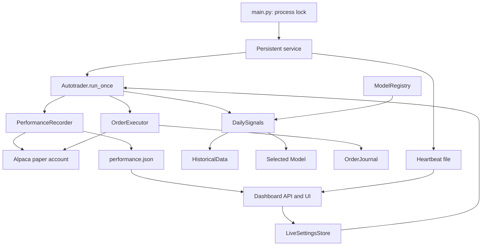

# Code architecture

The application runs two processes: a persistent paper trader and a FastAPI
control dashboard. They share configuration files; the dashboard also reads
trader status and cached account performance. The trader alone contacts Alpaca
for order execution and performance history.

## Packages

| Path | Responsibility |
| --- | --- |
| `main.py` | CLI, dotenv loading, logging, exclusive process lock and health check |
| `infrastructure/service.py` | Repeated cycles, deadlines, shutdown signals and heartbeat |
| `trading/runner.py` | `Autotrader`: dependency wiring, live settings and cycle coordination |
| `trading/features.py`, `trading/estimators.py`, `trading/ranking.py` | Reusable historical features, estimators and rank-model lifecycle |
| `trading/allocation.py` | Shared typed signal-to-target allocation for the new strategies |
| `research/` | Offline datasets, walk-forward evaluation, accounting and stress comparisons |
| `configuration/universe.py`, `configuration/universe.json` | Versioned 230-candidate catalog and additive configuration updates |
| `trading/signals.py` | `DailySignals`: model selection, daily preparation and candidate generation |
| `trading/execution.py` | `OrderExecutor`: shared eligibility, sizing and order submission guards |
| `data/historical.py` | Retrieve and align completed daily market bars |
| `core/contracts.py`, `core/types.py` | Model/Trader interfaces and shared data structures |
| `core/registry.py` | Discover trusted strategy files exporting a `MODEL` definition |
| `models/` | Ridge ranking, momentum rotation, boosted ranking and a template for new models |
| `brokers/account.py` | Shared Alpaca paper account and asset lookup through `Ticker` |
| `infrastructure/journal.py` | Persist daily attempt reservations and deduplication IDs |
| `infrastructure/performance.py` | Read-only portfolio history, fill pagination and validated report caching |
| `infrastructure/storage.py` | Atomic JSON state replacement |
| `configuration/settings.py` | Validated controls, persistence and revision conflict checks |
| `dashboard/app.py`, `dashboard/static/` | Authenticated settings/performance API and browser UI |
| `dashboard/__main__.py` | Dashboard server entry point |
| `configuration/legacy.py`, `brokers/paper_trader.py` | Older configuration and basic Trader implementation; outside the production runner path |

## Runtime flow

1. `main` loads the environment and locks the state directory. The service
   factory validates settings before creating broker clients.
2. Each cycle reloads changed settings and refreshes the performance report
   when due (at most once every five minutes), including while paused or closed.
   Ordinary reporting errors retain the previous cache. The runner then checks
   pause state, market hours, the daily attempt budget, open orders and the
   account/portfolio.
3. `DailySignals` loads history and prepares the selected model once per New
   York date. Model, universe or feed changes invalidate that cached preparation.
4. The model generates candidates from positions, equity and portfolio limits.
   `OrderExecutor` dispatches model decisions through the shared Trader contract,
   applies execution guards and reserves attempts before submission.
5. The journal preserves attempts across restarts. The service updates its
   heartbeat and waits for the next cycle; deadlines and failure limits control
   recovery. A heartbeat describes process progress, not order fills.

## State and component boundaries

`TRADER_STATE_DIR` holds `orders.json`, `heartbeat.json`,
`applied-settings.json`, `performance.json` and `runner.lock`.
`TRADER_CONTROL_DIR` holds shared controls and the dashboard access key. The dashboard writes controls, while the
trader records which revision it applied. Compose mounts trader state read-only
in the dashboard. See [operations](../docs/operations.md) for persistence details.

Scheduling belongs to the service, historical loading to the data layer,
strategy decisions to models, and broker submission to execution. The journal
has no broker dependency. `Autotrader` accepts injected signals, journal and
executor objects, plus an optional performance recorder; historical data
accepts a data client. The environment factory enables reporting with the
existing Alpaca client. The dashboard validates and reads the report through
`GET /api/performance`, returning 503 when it is missing or invalid.
Dependency injection lets the [offline tests](../tests/README.md) exercise components without real broker calls.

To add a strategy, follow [the model guide](../docs/models.md), implement the
`Model` contract and export `MODEL` from a new module in `models/`. Keep shared
execution constraints in `OrderExecutor`.

## Imports and entry points

`src/` is the source root: imports use `trading.runner`, `core.types`, etc.
Packaging retains these existing top-level packages and includes dashboard
static assets. Use a dedicated virtual environment to avoid generic package
name collisions.

From a checkout, run `uv run python src/main.py` or `uv run python -m src.main`.
Installed packages expose `ai-autotrader` and `ai-autotrader-dashboard`.
The trader supports `--help` and `--healthcheck`; configuration comes from the
environment. Runtime requires Python 3.13 and macOS/Linux (POSIX locks/signals).
See [release and packaging](../docs/releases.md) for distributable artifacts.
